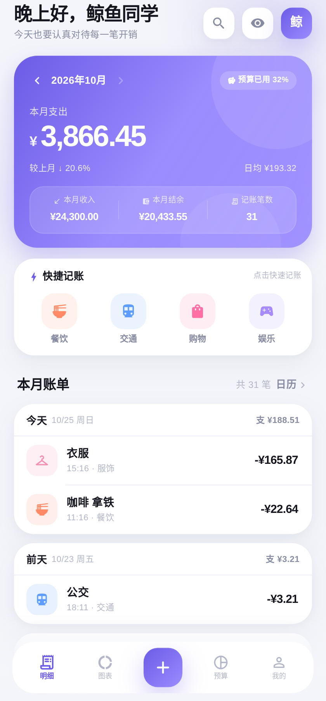
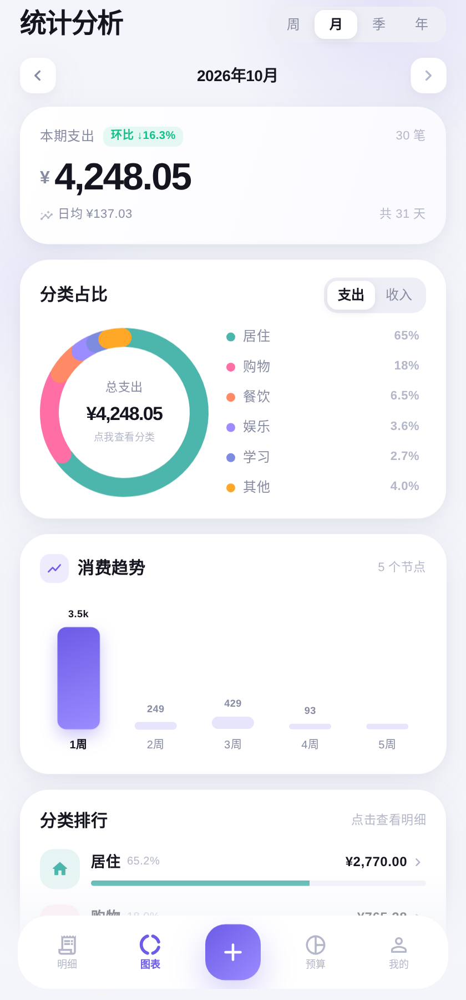
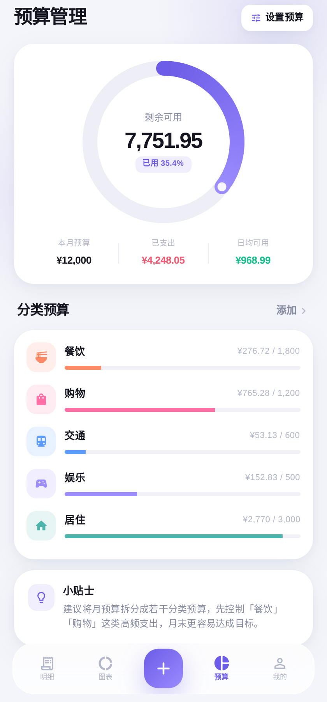
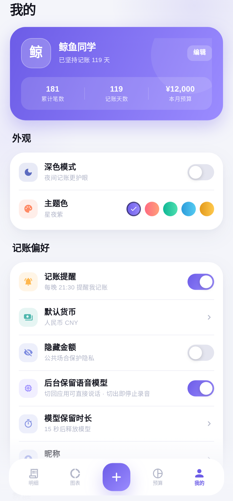

# 鲸记账 · Whale Ledger

[](https://github.com/niceday-hh/dsv41flash_app1/releases)
[](https://niceday-hh.github.io/dsv41flash_app1/)

> 🌐 在线体验：**https://niceday-hh.github.io/dsv41flash_app1/**
> 📱 下载 APK：**https://github.com/niceday-hh/dsv41flash_app1/releases/latest**

一款用 **Flutter** 打造的时尚轻盈记账 App，整体视觉参考「鲨鱼记账」等主流账本，融合 iOS 17 风格的大圆角卡片、磨砂玻璃底栏、渐变主视觉与细腻的动效。

> Android APK 与 Web 版由同一套 Flutter 代码构建。

---

## ✨ 功能特性

| 模块 | 说明 |
| --- | --- |
| 明细（首页） | 本月支出 / 收入 / 结余总览卡片，月份切换，按日分组账单；**搜索**、**点按编辑**、长按操作菜单、滑动删除（二次确认）、一键隐藏金额 |
| 图表 | **周 / 月 / 季 / 年** 四种周期、环形分类占比（可点击）、趋势柱状图（7 天 / 周 / 月 / 12 月自适应）、**分类排行钻取**、环比与智能洞察 |
| 洞察 | 7 类统计分析（环比 / 归因 / 频次×均额 / 周末节奏 / 集中度 / 周期账单 / 预算情景），含计算依据与关联账单 |
| 日历 | 月历热力图，按日查看收支明细 |
| 预算 | 月预算环形进度、超支预警、日均可用、分类预算管理 |
| 我的 | 深色模式、5 套主题色、隐藏金额、昵称、记账提醒、**CSV 文件导入 / 导出**、数据重置 |
| 记一笔 | 底部弹层 + 数字键盘，**支持 + − 计算**、**备注词云**（字号随频次变化）、**语音记账**、支出/收入切换、12 个分类、备注与日期 |
| 快捷操作 | 底栏 `+` 轻点直接记账，**按住上滑**可左右滑出「手动 / 语音」入口，松手执行 |
| 语音 | **完全离线**的中文语音记账：按住说话、松手识别，自动填入金额 / 分类 / 日期；可改文本重新拆分；模型随包内置，不联网、不上传 |
| 数据 | 本地持久化（`shared_preferences`），首次启动自动生成 6 个月演示账单 |

## 🆕 更新日志

### v1.5.6（配色回鲜 + 记账手感 + 中文标题字）
- **图表恢复鲜艳配色**：取消上一版的整体降饱和，环形图、分类排行、快捷入口、记一笔格子回到原本的高饱和分类色，图表页更有活力
- **记一笔更轻**：数字键盘改成浅灰无阴影、按压缩放 0.97；「全部」改成主题色描边的「更多」；金额为空时显示「输入金额」引导；保存按钮下方留白收紧 8px
- **首页连续时间轴**：同月账单收进一张卡，日期用胶囊节点串起来，不再是「一天一张浮卡」；有备注时旁边挂分类小标签，无备注不再留空行；金额列右对齐并等宽
- **保存反馈**：保存成功触发一次重触感 + 鲸鱼水花（水波扩散、鲸鱼上浮 700ms），弹层改为轻微回弹的上滑
- **中文标题用霞鹜文楷**：内置 1.8MB 子集（常用 3904 字 + 标点），标题与区块标题用它，正文仍走系统黑体
- **宽屏适配**：平板 / 折叠屏内容限宽 560 居中，底部导航同步收窄
- **数字等宽**：正文与标题统一 `tabularFigures`，金额列纵向对齐

### v1.5.5（语音预热对齐原版 + 品牌与配色统一）
- **语音准备中也能先说**：打开语音面板不再停在「正在加载模型」，模型未就绪时也可以按住说话，录音与加载并行，松手时通常已能直接识别（对齐拾光账本 3.1.4 的行为）
- **按住即触发加载**：录音一开始就并行推进模型准备，而不是松手后才开始等待；面板从后台返回时会自动补一次预热
- **冷启动不再读 227MB 模型**：改为记录模型代号做校验，只有首次安装或模型更新时才从 assets 解压，启动更轻、内存峰值更低
- **深色模式卡片更清晰**：提高卡片与背景的明度差，并加 1px 高光描边，暗色下不再是「一片黑」
- **鲸鱼符号落地**：首页右上角与关于页的「鲸」字换成手绘鲸鱼，与启动图标、空状态插画同源
- **配色收敛**：40+ 个分类色统一降饱和处理，环形图、分类排行、快捷入口、记一笔格子不再各说各话；分段控件底色加深，选中态更明显
- **圆角统一**：全局收敛为 10 / 14 / 20 / 28 四档

### v1.5.4（日历在线更新 + 隐私联动 + 细节修复）
- **日历资料可在线更新**：接入 holiday-cn（国务院公告整理）拉取法定放假与补班，接入香港天文台节气表补齐任意年份；默认打开应用时检查今年与明年，24 小时最多一次，也可在「设置 → 日期资料」手动检查指定年份，并展示公告来源
- **补班标注**：更新后补班日会显示「班」角标，节假日显示名称，比原来只有节气/公历节日更准
- **隐藏金额全链路**：趋势图峰值、日历热力色阶、周视图柱内数字、月/年汇总一并打码；隐藏后日历只保留「有没有记账」，不再能从深浅看出花多花少
- **修复备注次数**：只使用过 1 次的备注不再显示成「2 次」
- **快捷入口更好按**：上滑后改为按左右方向判定并加迟滞，手指继续往上划也不会丢掉选中项

### v1.5.3（趋势图标注 + 语音复核重做 + 分类格子重排）
- **趋势图标注**：当前周期包含今天时，在对应节点画一条蓝色竖虚线并标「今天」；同时用红色虚线标出周期峰值并显示「峰值 ¥x」
- **点节点直接看条目**：选中某个日期/月份后，卡片下方立刻列出当天的前 4 笔（图标、备注、金额），超过 4 笔才有「查看全部」
- **备注提取重做**：「买咖啡花了 28 块」现在只记「咖啡」，不再把整句塞进备注；去掉金额、时间副词、记账口令与动词后只留对象
- **语音复核改成大弹窗**：识别原文可编辑，下面按「分类 / 金额 / 日期 / 备注」四行逐项预览与修改，另有支出/收入切换，内容超高可滚动
- **记一笔分类格子重排**：图标统一 36、格子行距拉大到 8、选中时在图标外画细环而不是套住整格，文字不再被边框压住；「全部」与其他分类尺寸一致

### v1.5.2（新图标 + 折线趋势 + 日历逐日明细 + 语音规则补齐）
- **全新应用图标**：白色小鲸鱼 + 海洋渐变，去掉原来的「鲸」字；自适应图标、启动图、网页 favicon 与 Flutter 启动动画全部换成同一只鲸鱼
- **趋势图改为折线**：周按天（7 点）、月按天（当月天数）、季按月（3 点）、年按月（12 点），带渐变面积、网格与节点点选
- **点折线节点看明细**：选中某个日期/月份后显示金额与笔数，点「查看 N 笔」直接列出当天（或当月）的每一笔
- **日历视图支持点日期**：周、月视图点任意一天都能看到当天所有条目，不再只有季/年才能下钻
- **语音解析规则补齐**：口语简写（一百二=120、一千五=1500）、角分（三块二毛五）、人民币/¥ 前缀、动词后裸数字、总额/更正优先级、多金额提示、明天/后天/N天前/上周五/上个月X号等日期、显式「分类是交通」、按历史备注推荐分类
- 语音回归测试从 12 条扩到 17 条，覆盖上述规则

### v1.5.1（对照拾光账本补齐交互 + 真实提醒）
- **报表「支出分析 / 收入分析」提到页面顶部**：指标卡、构成环形、分类排行、趋势、日历整体随模式切换
- **换分类支持搜索 + 最近使用**：搜索框 + 最近 6 个快捷 chip + 全部分类网格，42 个分类不用再翻
- **首页切月后有「回到本月」**：翻到几个月前也能一步回来
- **备注词云**：字号随使用次数放大，颜色取自最常用的分类并做深浅阶梯；本分类备选太少时自动补几条其他分类的常用备注
- **记一笔点备注**：数字键盘让位给词云选择器，可搜索、可手写，选完回到键盘
- **分类下钻明细**：支持时间新→旧 / 旧→新、金额高→低 / 低→高 4 种排序，并显示单笔占比
- **季 / 年日历点月份**：直达该月全页日历
- **宽屏适配**：宽度 ≥600 时「分类占比」与「分类排行」并排
- **常用备注条数可配**：4 / 6 / 8 / 12 / 16 / 20 / 24
- **记账提醒接上系统通知**：AlarmManager 每日触发，开机与升级后自动补登记，设置里可发一条测试通知
- 修复设置页版本号写死 `v1.0.0`、导入导出副标题与文件选择器行为不一致的问题

### v1.5.0（分类扩充 + 日历体系 + 洞察补完）
- **分类扩充到 42 个**：支出 34 类、收入 8 类，与原版一致；记账面板 5 列两行，第 10 格「全部」可查看完整列表
- **报表新增「统计 / 日历」双视图**：日历跟随当前周期（周 / 月 / 季 / 年），月视图按当日金额深浅着色，季年视图为多月缩略网格
- **日期资料**：内置 2025–2027 二十四节气 + 16 个公历节日 + 周末标注，全部本机计算，不联网
- **洞察补完**：新增「异常金额线索」（同分类 90 天基线 + MAD 稳健 Z > 3.5）；每条结论增加一段**白话解释**，与技术口径的「计算依据」分开
- **备注选择器**：常用 / 最近 / 全部 三档排序 + 搜索 + 「仅本分类」筛选，显示使用次数
- **搜索支持分类筛选**：结果上方按金额排序的分类 chip，点击收窄
- **趋势节点可点选**：点任意柱查看该节点金额，无记录时明确提示
- **排行榜名次**：前三名高亮；长按菜单新增「查看详情」只读弹层
- **提醒时间可调**：点击设置项选择时分
- **快捷入口重塑**：按住底栏 `+` 上滑改为径向扩散遮罩，两枚入口以轻弹性浮起，图标底色取自当前主题色，与整体配色统一

### v1.4.0（语音重做 + 交互提速）
- **语音改为「按住说话」**：长按录音、松手即识别，30 秒上限自动结束；取消滑出即中止
- **换用 Paraformer-zh INT8 模型**（227MB，随 APK 打包），识别准确率较 14M 流式模型明显提升
- **推理移入独立 isolate**：解码不再占用 UI 线程，长句也不掉帧
- **首帧预热 + 后台保留**：启动后即预加载模型，切后台默认保留 15 秒（可在设置改 5/10/15/30），内存压力时自动释放
- **识别后可修正**：结果文本可直接编辑并自动重新拆分；已手动改过的分类/金额/日期不会被覆盖
- **解析规则增强**：全角数字、千分位、否定句（「不是买衣服是打车」）、屏蔽数量/时长/时间点、显式「备注X」、相对日期与周几
- **底栏 + 按住上滑**：左右滑出「手动记账 / 语音记账」，滑到目标松手即进入，滑回取消
- **首页行内快捷编辑**：点分类换分类、点标题改备注、点金额弹出独立数字键盘，无需进整页
- **数据层重做**：JSON 文件原子写入（临时文件 + rename）、保存合并队列、≥200 条走 isolate、启动恢复期间不覆盖用户已做的编辑

### v1.3.0（补齐 3.1.4 的语音与文件能力）
- 新增 **离线语音记账**：内置 sherpa-onnx + 中文流式 Zipformer 模型（约 30MB，随 APK 打包）
  - 原生 16kHz 单声道 PCM 采集（Kotlin `AudioRecord` + EventChannel），无需第三方录音插件
  - 边说边出字，实时解析「昨天打车二十八块五」→ 金额 / 分类 / 日期 / 收支
  - 支持中文数字（「两千六百」）、角分（「十五块五」）、相对日期（今天/昨天/前天/大前天）、14 类目关键词推断
  - 全程本地推理，**不联网、不上传音频**
- 新增 **备注词云**：按历史使用频次排版，字号与色深随频次变化，点一下即填入
- 新增 **原生文件导入导出**：Android 通过系统文件选择器读写 CSV（`ACTION_CREATE_DOCUMENT` / `ACTION_OPEN_DOCUMENT`），其余平台自动回退到剪贴板
- 导入支持「追加 / 替换」两种模式，表头校验失败会给出明确提示
- 升级构建链：Flutter 3.24 + AGP 8.3 + Gradle 8.6 + SDK 34；APK 仅保留 `arm64-v8a` / `armeabi-v7a`，体积从 193MB 降到 112MB
- 底栏不透明度提升，修复内容穿透导致的可读性问题；各页底部留白统一

### v1.2.0（对齐 拾光账本 3.1.4 的能力）
- 新增 **消费日历**：月历热力格（按当日金额深浅着色）+ 当日明细、最高单日、弹指切换月份
- 新增 **消费洞察**：等长时段对比、变化来源、频次 × 单笔均额、周末/工作日日均、支出集中度（HHI）、疑似周期账单、月末预算情景
  - 每条结论可展开「计算依据」，并可查看**关联账单**（点进还能直接编辑）
  - 预算情景支持滑块模拟：下调后预测月末支出与结余
- 新增 **快捷入口**：长按底栏 `+` 呼出「记一笔 / 消费日历 / 消费洞察」
- 报表页的洞察卡改为可点击，直达完整洞察
- 趋势柱状图改为细柱 + 高亮当前最大值，视觉更清爽

### v1.1.0
- 新增 **搜索**：按备注 / 分类 / 金额检索，含分类快捷入口与最近记录
- 新增 **编辑账单**：点击账单直接改金额、分类、备注、日期；长按呼出操作菜单，删除需二次确认
- 报表升级为 **周 / 月 / 季 / 年** 四种周期，趋势图节点自适应，支持环比与「回到本期」
- 新增 **分类钻取**：点排行榜任意分类查看该分类明细
- 记账键盘支持 **加减运算**（输入 `12+8` 自动算 20），并推荐该分类的**常用备注**
- 新增 **隐藏金额**：首页眼睛图标一键打码，全局生效
- 新增 **CSV 导入**：粘贴文本即可导入，自动识别分类与日期
- 视觉细节：分段控件支持 4 段、分类网格重排、预算环渐变重绘

## 🎨 设计要点

- **iOS 风格**：大圆角（26–32dp）卡片、低透明度大扩散阴影、磨砂玻璃导航栏、SF 字体回退链（PingFang / HarmonyOS Sans）
- **动效**：
  - 开屏 Logo 弹入 + 淡入
  - 金额数字滚动（`TweenAnimationBuilder`）
  - 分类环形图扫描式生长、可点击选中高亮
  - 柱状图逐根生长（`Interval` 错峰）
  - 预算环分段渐变描边 + 端点高光
  - 账单列表错峰淡入上浮
  - 底部 Tab 图标弹性缩放、分段控件滑动指示器
  - 所有可点击元素带按压缩放反馈与触感震动
- **深色模式**：完整的深色调色板，非简单反色
- **响应式**：手机全屏；桌面浏览器自动以「手机画幅」居中呈现
- **语音链路**：Kotlin `AudioRecord` 采集 16kHz PCM → EventChannel → Dart 缓冲 → 独立 isolate 跑 sherpa-onnx Paraformer-zh → 规则解析成账单字段

## 📱 截图

| 首页 | 图表 | 预算 | 我的 |
| --- | --- | --- | --- |
|  |  |  |  |

## 🚀 本地运行

> 环境要求：**Flutter 3.24+**（Dart 3.5+）、JDK 17、Android SDK 34。语音模块依赖 `sherpa_onnx` 的原生库，需要真机或有麦克风的模拟器。

```bash
flutter pub get
flutter run                 # 连接手机 / 模拟器
flutter run -d chrome       # 浏览器预览
```

## 📦 构建

```bash
# Android APK（release 构建需自行配置签名）
flutter build apk --release --build-name=1.3.0 --build-number=4

# Web（GitHub Pages 路径）
flutter build web --release --web-renderer html --base-href /dsv41flash_app1/
rm -f build/web/flutter_service_worker.js   # 关闭 SW，避免 CDN 缓存导致白屏
rm -rf build/web/assets/assets/asr build/web/assets/packages/sherpa_onnx_web   # Web 版不含语音模型
```

产物：

- APK：`build/app/outputs/flutter-apk/app-release.apk`
- Web：`build/web`


## 🗂 项目结构

```
lib/
├── main.dart              # 启动引导、主题、桌面画幅适配
├── app_shell.dart         # 4 个 Tab + 玻璃底栏 + 背景光晕
├── theme.dart             # 调色板 / 字体链 / ThemeData
├── models.dart            # Bill、CategoryDef、DayGroup
├── data.dart              # 分类定义与演示账单生成
├── store.dart             # 状态管理（ChangeNotifier + 本地持久化）
├── pages/                 # home / stats / budget / settings
└── ui/                    # common（通用组件）、charts（图表）、add_sheet（记账弹层）
```

## 🔧 技术栈

- Flutter 3.0 / Dart 2.17（无第三方 UI 库，图表全部自绘 `CustomPainter`）
- `shared_preferences` 本地存储
- `flutter_localizations` 中文本地化

## 📄 License

MIT
